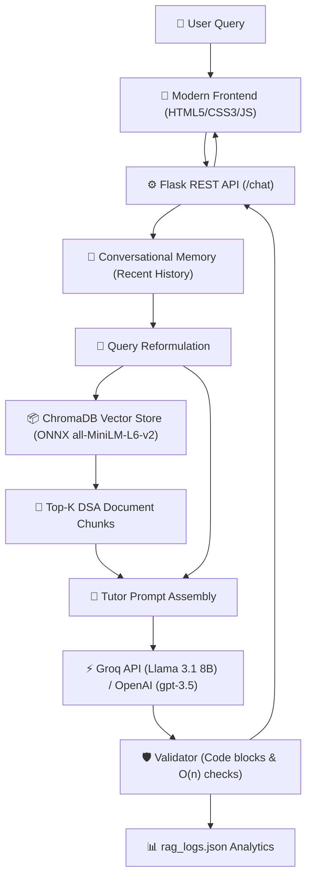

# 🧠 Neural RAG for DSA (Data Structures & Algorithms)

An end-to-end, production-ready **Retrieval-Augmented Generation (RAG)** assistant designed to answer complex Data Structures and Algorithms questions with zero manual document lookup. Built with **Flask**, **ChromaDB**, **LangChain**, and ultra-fast inference via **Groq (Llama 3.1 8B)** with optional **OpenAI** support.

---

## ✨ Features

- 🔍 **Grounded Semantic Retrieval**: Powered by ChromaDB using ONNX-accelerated 384-dimensional `all-MiniLM-L6-v2` embeddings for fast, memory-efficient vector search.
- ⚡ **100% Free, High-Speed LLM Inference**: Integrated with Groq's LPU-powered Llama 3.1 8B (capable of 500+ tokens/sec) with automatic fallback to OpenAI.
- 💬 **Conversational Context & Query Rewriting**: Retains chat history and dynamically reformulates follow-up questions into standalone search queries.
- 🛡️ **Response Validation & Analytics**: Evaluates responses for time-complexity mentions (e.g. $\mathcal{O}(n)$, $\mathcal{O}(\log n)$) and code formatting, logging interactions for auditability.
- 🎨 **Modern Glassmorphic UI**: Sleek frontend with responsive dark mode, smooth message animations, auto-expanding text areas, and dynamic chat history.
- 🚀 **One-Click Cloud Deployment**: Pre-configured with `render.yaml` and Gunicorn for deployment on Render's free tier (< 512 MB RAM footprint).

---

## 🏗️ Architecture



---

## 📂 Project Structure

```text
├── backend/
│   ├── app.py                     # Flask API & static file serving
│   ├── final.py                   # Production RAG pipeline (Groq/OpenAI + ChromaDB)
│   ├── ingestion_pipeline.py      # Document chunking & embedding creation
│   ├── retrieval_pipeline.py      # Standalone retrieval pipeline tester
│   ├── history_aware_generation.py# Multi-turn conversational generation module
│   ├── db/
│   │   └── chroma_db/             # Pre-computed vector embeddings for DSA
│   └── docs/                      # Source DSA reference books & guides
├── frontend/
│   ├── index.html                 # Main chat interface
│   ├── style.css                  # Modern glassmorphism dark theme
│   └── script.js                  # Asynchronous chat client logic
├── render.yaml                    # One-click Render cloud deployment blueprint
├── requirements.txt               # Lightweight production dependencies (no PyTorch bloat)
├── resume_description.md          # Bullet points tailored for resumes/portfolios
└── README.md
```

---

## 🚀 Quickstart (Local Development)

### 1. Clone & Set Up Virtual Environment

```bash
git clone https://github.com/HarshKumar-17/RAG-for-DSA.git
cd RAG-for-DSA

# Create and activate virtual environment
python -m venv venv
# Windows:
.\venv\Scripts\activate
# macOS/Linux:
source venv/bin/activate

# Install lightweight dependencies
pip install -r requirements.txt
```

### 2. Configure Environment Variables

Create a `.env` file in the `backend/` directory:

```env
# Free API key from https://console.groq.com/keys
GROQ_API_KEY=gsk_your_groq_api_key_here

# (Optional) If you prefer OpenAI:
# OPENAI_API_KEY=sk-proj-...
```

### 3. Run the Application

```bash
cd backend
python app.py
```

Open your browser and navigate to:
```
http://localhost:5000
```

---

## ☁️ Deploy to Render (100% Free)

This project is optimized to run smoothly on **Render's free tier** (512 MB RAM limit).

1. Push this repository to your GitHub account.
2. Go to [dashboard.render.com](https://dashboard.render.com/) and click **New +** → **Web Service**.
3. Connect your repository.
4. Render will automatically read `render.yaml`. If configuring manually:
   - **Environment**: `Python`
   - **Build Command**: `pip install -r requirements.txt`
   - **Start Command**: `cd backend && gunicorn app:app --bind 0.0.0.0:$PORT --timeout 120`
5. In **Environment Variables**, add:
   - `GROQ_API_KEY` = your free key from [console.groq.com](https://console.groq.com)
   - `PYTHON_VERSION` = `3.11.11`
6. Click **Create Web Service**.

---

## 🛠️ Tech Stack

- **Core Framework**: Python 3.11, Flask, Gunicorn
- **Orchestration & RAG**: LangChain Core, ChromaDB (Native ONNX)
- **Embeddings**: `all-MiniLM-L6-v2` (384 dimensions)
- **LLM Providers**: Groq Cloud (`llama-3.1-8b-instant`), OpenAI (`gpt-3.5-turbo`)
- **Frontend**: Vanilla JavaScript (ES6+), HTML5, Glassmorphic CSS3
- **DevOps / Cloud**: Git, Render Cloud PaaS

---

## 📄 License

This project is licensed under the [MIT License](LICENSE).
